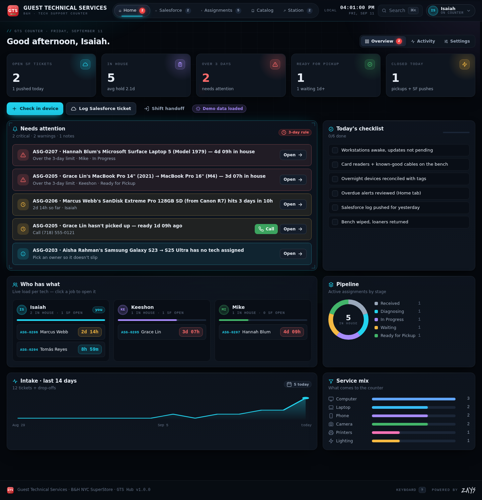
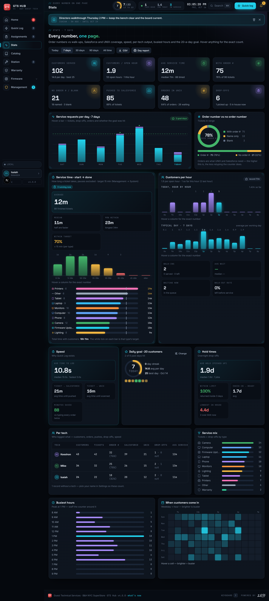
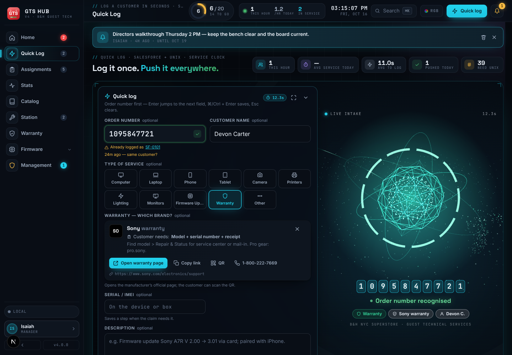
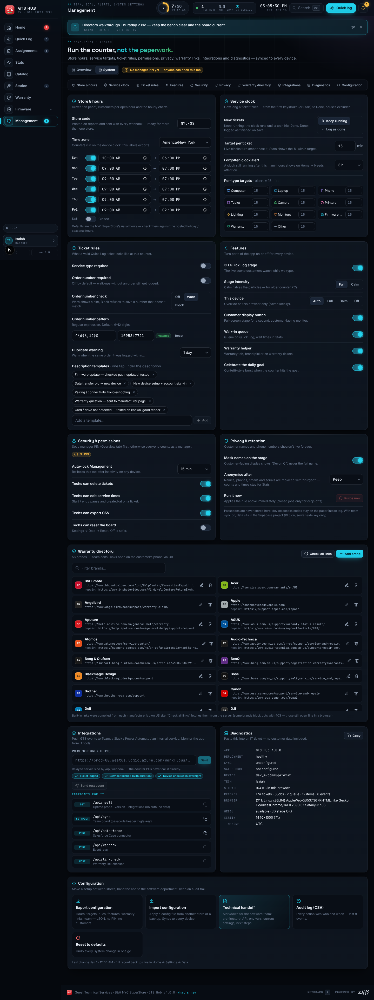
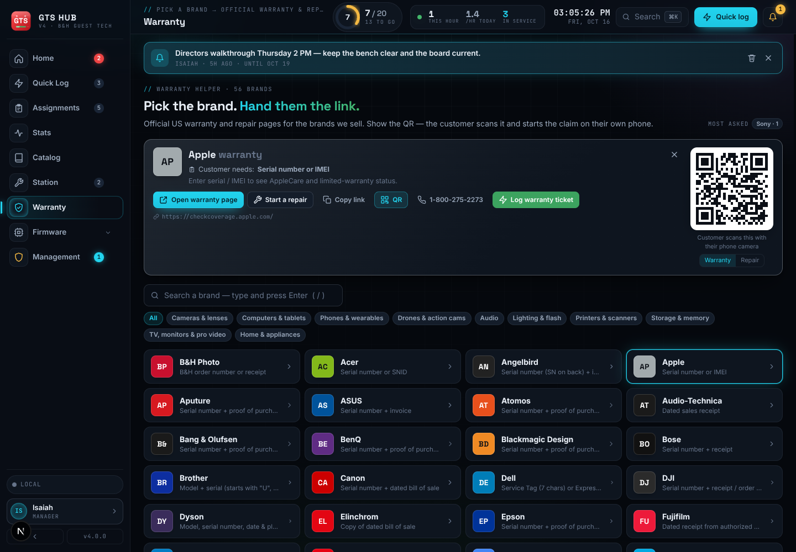
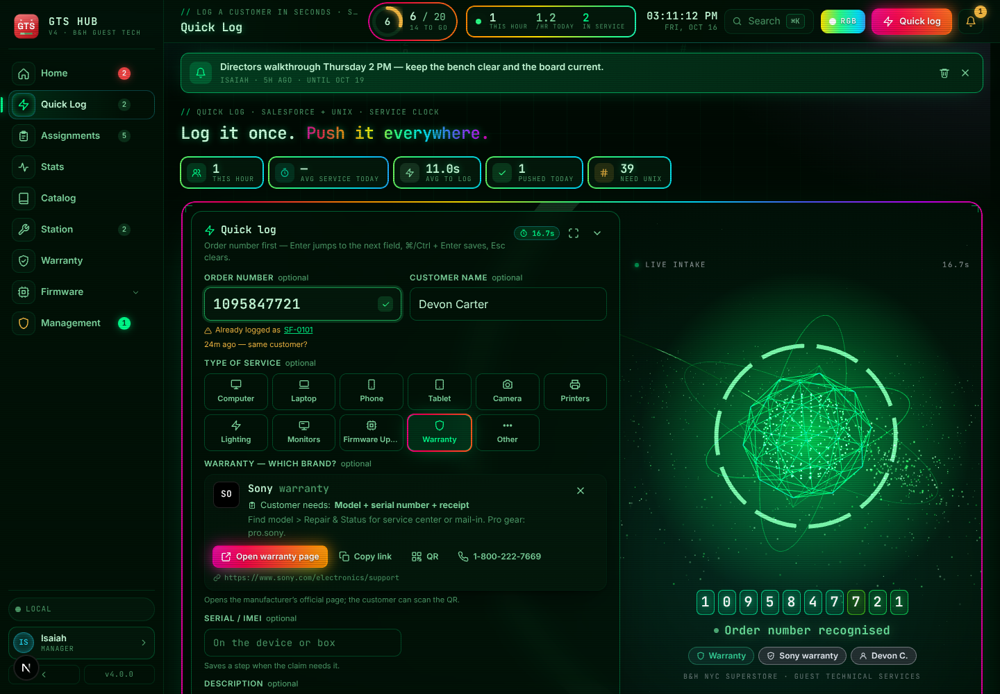

# GTS Hub V4 — Guest Technical Services

The B&H GTS counter, on one live board. **Log a customer once, push it everywhere**: Salesforce, UNIX, the overnight board — with every number the directors could ask for on one Stats page.

| Home | Stats |
|---|---|
|  |  |

| Quick Log (3D stage) | Management → System |
|---|---|
|  |  |

| Warranty helper | Matrix theme + RGB mode |
|---|---|
|  |  |

Built with Next.js (App Router) + React, a hand-rolled design system (no UI libraries), Supabase for the live team board, and an optional Salesforce Connected App. Deploys to Vercel as-is. Live at **https://gts-hub.vercel.app**.

---

## What’s new in V4

* **Quick Log stage (three.js)** — the Quick Log card now sits on a live 3D stage the customer can watch. A light-beam connects whichever field you are typing in to a glowing core; every keystroke streams particles down it, the 10-segment ring lights up digit by digit as the order number goes in, the colour follows the service type (or the warranty brand), and saving fires a shockwave. The right side is a customer-facing HUD: the order number assembling in big digit slots, a decoding status line (“Order number recognised”), the service, the brand and the customer’s name masked as “Devon C.”. **Customer display** (⤢) puts the whole stage full screen for a second monitor. three.js is lazy-loaded (only on Quick Log), pauses when hidden, respects reduced motion, and falls back to a 2D glow when WebGL is missing.
* **Service clock — how long a ticket takes.** Every ticket gets a clock from the first keystroke (or a manual Start) to **Done**, with **Pause / Resume**, and Resume after Done for customers who come back. **Now serving** shows every running clock big, turning amber past the target and red past 2×. Full control: edit start, finish, paused minutes and the created-at time on any ticket (Management can lock that). Stats shows average, median, 90th percentile, % within target, a duration histogram, average by service type against its target, and average + total service time per tech. Forgotten clocks raise an alert.
* **Customers per hour** — a live *this hour · per hour today · in service* pill in the top strip, today’s hour-by-hour chart, a “typical day” chart, customers per **open** hour (using real store hours), the record hour, plus a printable **end-of-day report**.
* **Multi-select + bulk actions** — tick the box on any card (or click rows in the new **table layout**, 400 rows), shift-click for a range, ⌘/Ctrl + A for the whole view, Esc to clear. The bar at the bottom moves the selection between **Open → Pushed**, **Needs UNIX → In UNIX** (and back), stops running clocks, **Archives** (new *Archived* view; archived tickets still count in Stats), reassigns the tech, changes the type, exports CSV or deletes — with Undo.
* **Warranty helper** — new *Warranty* tab (`9`) and a **Warranty** service type. Pick a brand (56 built in: Apple, Samsung, Sony, Canon, Nikon, Dell, HP, DJI, Bose…) and get the official US warranty-check page, the repair page, the support phone, what the customer needs ready, and a **QR code** they scan to start the claim on their own phone. Warranty tickets keep the brand and serial. Managers can correct or add links (Management → System → Warranty directory) and **Check all links** from the server.
* **Walk-in queue** — add people as they arrive (`W`), see live wait times (amber at 15 min, red at 30), tap **Serve** and the Quick Log fills itself in; their wait and their service time are both measured. Walk-outs are tracked.
* **Management → System** — everything the software department asked for: store code + per-weekday store hours, service-clock default + targets (global and per type), ticket rules (required fields, order-number pattern with warn/block, duplicate window, description templates), feature switches, **security** (auto-lock after idle, per-permission tech controls), **privacy** (name masking on the customer display, anonymise after N days), **integrations** (HTTPS webhooks to Teams / Slack / Power Automate, `/api/health` for uptime monitoring), **diagnostics** you can paste into an IT ticket, **config export / import** between stores, an **audit log** CSV and a generated **technical handoff**. See [`docs/SOFTWARE_HANDOFF.md`](docs/SOFTWARE_HANDOFF.md).
* **Matrix theme + RGB mode** — a third theme (green phosphor, digital rain, scanlines, mono headings) and digital rain on the stage in every theme. **RGB mode** (`R`, or the RGB pill in the strip) runs one rainbow wave across the hero buttons, the metric tiles and the stage, and cycles the 3D core through the spectrum; it switches itself on for a few seconds when the daily goal is hit (with confetti).
* **Smoother everywhere** — Enter jumps to the next field, ⌘/Ctrl + Enter saves, Esc clears; order-number check mark + digit count; one-tap description templates; duplicate-order warning; touch devices don’t pop the keyboard on open; page titles decode in; columns and charts animate in; the T modal has the same fields as the stage.
* Keyboard: `1–9` tabs · `T` quick log · `W` walk-in · `N` check-in · `R` RGB · `/` search · `⌘K` palette · `[` rail · `?` all shortcuts.

---

## What’s new in V3

* **Quick Log** (was “Salesforce”) — the order number is the only thing that matters, so it is the first field. A **stopwatch** starts at your first keystroke and the ticket remembers how long it took (`⏱ 6.2s` on the card). Three ways to finish: *Add to log*, *Add & check in device*, *Add & push to UNIX*. Every ticket card shows a **SF / UNIX** status pair so you can see at a glance what still needs to go where.
* **Stats tab** — every number on one page: customers served vs the daily goal, **order number vs no order number**, Salesforce and UNIX coverage, speed (avg time to log, ticket → Salesforce, ticket → UNIX, minutes saved vs double entry), hold times, per-tech table, service mix, busiest hours, a weekday × hour heatmap, and CSV exports. Ranges: today / 7 / 30 / 90 days / all time.
* **Intake chart** on Home (and Stats) is **hoverable** — every bar is a day, hover shows exactly how many service requests came in (tickets, drop-offs, with order #, goal hit or short by how many). Tickets that later became a drop-off are counted once.
* **Daily goal** — default **20 customers a day**, shown as a ring in the top strip and on Home (“15 to go · ~12 expected by now”), with streaks and hit/miss days in Stats. Managers change it with one click (15 / 20 / 25 / 30 / 40 or any number) and choose how loud it is (subtle / bold / off).
* **Management tab** — team roster (add, rename, recolor, remove and restore techs — every device updates live), **team alerts** (a banner at the top of every screen, three tones, optional expiry), the daily goal, a **manager PIN** (SHA-256, shared across devices; until one is set the tab is open), **connections** (Salesforce, UNIX, team board) and one-click exports.
* **Salesforce integration** — with a Connected App configured (three env vars), *Push to Salesforce* creates a real **Case** and stores the Case number + link on the ticket. Without it, the button still works as the “I entered it” flag it always was.
* **UNIX scan bridge** — *Push to UNIX* shows the order number as a **Code 128 barcode**. A USB barcode scanner plugged into the WYSE terminal types it into UNIX with Enter — no software on B&H machines, nothing for the firewall to block. Details below.
* **New shell** — sidebar rail with badges and keyboard hints (collapsible with `[`), command strip with the goal ring, who’s online, live clock, search and a Quick log button that is never more than one click away. Same colors, same neon framing, a lot more room.
* Keyboard: `1–7` tabs · `T` ticket · `N` drop-off · `/` search · `⌘K` palette · `[` collapse rail · `?` all shortcuts.

---

## Run it

```bash
npm install
npm run dev        # http://localhost:3000
```

## Deploy to Vercel

1. Push this folder to a GitHub repo.
2. In Vercel: **Add New → Project → Import** the repo. Framework is auto-detected (Next.js). No env vars are needed for local mode.
3. Deploy. Open the URL on the counter PC / iPad / phones and pick your tech (the app asks on first launch; change it any time by clicking your name in the rail).
4. For the shared live board attach Supabase (*Team sync* below). For real Salesforce Cases add the three `SF_*` variables (*Connections* below).

Or from the folder: `npx vercel` (then `npx vercel --prod`).

---

## What’s inside

### Home
* **Today at the counter** hero: customers served, pushed to Salesforce, orders in UNIX, avg time to log — plus the goal ring and pace.
* **Needs attention** — every device over the limit (default **3 days**, configurable), devices ready but not collected, waiting jobs with no update, unassigned jobs, tickets not pushed to Salesforce, orders not in UNIX, gear checked out to closed jobs. Critical items glow red; the Home badge shows the critical count.
* KPIs, the hoverable **Intake · last 14 days** chart, the shift checklist, pipeline donut, **Who has what** per tech, service mix.
* **Activity** — audit feed of everything anyone did (tickets, drop-offs, team changes, alerts, goal changes), with who and when.
* **Settings** — overdue threshold, station name, counter phone (printed on claim tickets), theme, sounds, backups (JSON/CSV), restore, demo data, and **Team sync**.

### Quick Log
* Order number first, name optional, service type, description, tech. `⌘/Ctrl + Enter` saves. The stopwatch runs from the first keystroke.
* Blank tickets (no order number, no name) are allowed but need a service type or description so the entry means something later.
* Views: Open · Needs UNIX · Pushed · Converted · All. Search matches order numbers, names, tags and Case numbers.
* **Push to Salesforce** creates a Case when the connector is configured (Case number and “Open Case” link on the card), otherwise flags the ticket. **Push to UNIX** opens the barcode. **Push to Assignments** opens the overnight intake pre-filled and links both records.

### Assignments (overnight drop-offs)
* Intake requires name + phone (email optional). Also: order #, device make/model, requested work, accessories left, storage spot, “customer provided passcode” flag (never the passcode itself), promised-by date, tech, catalog task suggestions.
* Hold-time badge ticking live in every card corner (`1h 29m` → `2d 14h` amber → `4d 09h` red past the limit).
* Auto-criticality from device age, promised date, deadline words, data-loss language and whether the customer is without their main device; manual override.
* Board (drag between stages), List and Archive views; detail drawer with stepper, call / text / email, task checklist, work log, print intake tag + claim ticket, ready / picked up / cancel / reopen / delete with undo.

### Stats
See *What’s new*. All numbers come from one pure function (`lib/stats.js`) so Home, Stats and Management always agree.

### Catalog
The 17-area / 124-type GTS service catalog, searchable, with scope + “done when” evidence and Core / Discussed / Proposed labels. Any entry can be attached to an active job as a checklist task.

### Station
Inventory (serialized assets, counted pools, consumables with low-stock alerts; check out / check in / quarantine) and the shift handoff sheet.

### Firmware (Update / Install Firmware)
The **Camera Firmware Hub** (made for B&H by ZAYS.us) embedded as its own page: search 439 cameras, lenses, flashes and accessories by name or model code, see the latest firmware with install steps, download the file or jump to the official page, plus the Windows ISO guide. Sections (Cameras · Lenses · Flashes & Lighting · Accessories · Windows ISO · About) are a dropdown under *Firmware* in the rail and chips above the page; `8` opens it. The shell eases into the hub's espresso palette while it is open. The hub itself lives in `public/firmware/` and is built from the Camera Firmware Hub project (`python3 tools/build_web.py --gts <this repo>`).

### Warranty
Brand directory (`lib/warranty-data.js` + team overrides in the management document): official warranty and repair pages, phone, prerequisites and a QR per brand. One click logs a warranty ticket.

### Management
**Overview:** Team · Alerts · Daily goal · Manager PIN · Connections · Exports. **System:** Store & hours · Service clock · Ticket rules · Features · Security · Privacy · Warranty directory · Integrations · Diagnostics · Configuration. Managers see it in the rail; once a PIN is set, techs get a lock screen (auto-locks again after the idle time set in System). The PIN unlock is remembered per device.

---

## Connections

### Team sync — one live board for all of you (Supabase)

Without a database the app runs in **local mode** (each browser keeps its own records). Attach the free Supabase database and every edit shows up on the other screens within about a second, with a “who’s online” indicator in the strip.

1. Vercel → project → **Storage** → **Create Database** → **Supabase**. Vercel injects `SUPABASE_URL`, `SUPABASE_ANON_KEY`, `SUPABASE_SERVICE_ROLE_KEY` and `POSTGRES_URL` automatically. Redeploy.
2. First device: **Settings → Team sync → Create the team passcode**. The table is created automatically on first contact.
3. Everyone else: Settings → Team sync → type the passcode → *Connect*. The rail dot turns green and says **LIVE**.

**If sync stops with "Team database unreachable"**: the free Supabase project pauses after 7 idle days (or was deleted). Open supabase.com → the project → *Restore*, then Settings → Team sync → *Retry*. From V3.1 a Vercel cron (`vercel.json`) hits `/api/keepalive` every day so the project stays awake; set `CRON_SECRET` in Vercel to lock that route down. The error text now says what is wrong (unreachable / paused / key rejected) instead of "fetch failed".

How it works: one JSON document with a revision counter in the `gts_sync` table; writes are compare-and-set; conflicts merge record by record (newest `updatedAt` wins, deletions are tombstoned, merges are canonical so devices converge); every write fires a Supabase Realtime broadcast so open devices pull immediately; presence on the same channel powers the online avatars. The team roster, alerts and management settings (goal, PIN hash) are part of the shared document. Your tech, theme, sounds and passcode never leave the device.

### Salesforce — real Cases from Quick Log

Ask the B&H Salesforce admin for a **Connected App** with the **OAuth 2.0 Client Credentials Flow** enabled and a run-as user (integration user) that can create Cases. Then in Vercel → Settings → Environment Variables:

| Variable | Value |
|---|---|
| `SF_INSTANCE_URL` | the org URL, e.g. `https://bhphoto.my.salesforce.com` |
| `SF_CLIENT_ID` | the Connected App consumer key |
| `SF_CLIENT_SECRET` | the Connected App consumer secret |
| `SF_CASE_ORIGIN` (optional) | a valid Case *Origin* picklist value (default `Web`) |
| `SF_CASE_RECORD_TYPE_ID` (optional) | Case record type id, if the org uses record types |
| `SF_CASE_FIELDS_JSON` (optional) | extra fields on every Case, e.g. `{"Department__c":"GTS"}` |

Redeploy, then **Management → Connections → Test connection**. From then on *Push to Salesforce* creates a Case (`Subject: GTS · Order 1095847721 · Camera`, description with the ticket details, `SuppliedName` = customer) and stores the Case number and link on the ticket. Secrets stay on the server; the browser only ever talks to `/api/salesforce`, gated by the team passcode.

### UNIX (WYSE terminal) — the scan bridge

The order system has no API, the firewall blocks this app on the B&H machines, and the terminal only understands keystrokes. A **USB barcode scanner is a keyboard**, so:

1. *Push to UNIX* on a ticket shows the order number as a **Code 128 barcode** (big, high-contrast, works on a phone or tablet screen).
2. The tech scans it with a scanner plugged into the WYSE (or the PC running the terminal emulator). The scanner types the digits and presses Enter — the terminal doesn’t know the difference.
3. *Mark as entered in UNIX* — the ticket shows **UNIX ✓**, Stats counts coverage, Home flags orders that still need it.

Needs: any USB HID barcode scanner (≈$25–60, e.g. a Tera / NADAMOO / Inateck 1D scanner) with the **Enter suffix** on (usually the default). The modal has a self-test: scan into it and it confirms the scanner is typing the digits + Enter.

Next steps that need IT: whitelist `gts-hub.vercel.app` on the counter PCs so the barcode is on the same screen as the terminal, and — if the terminal is a Windows emulator (PuTTY, TinyTERM, ZOC…) — an AutoHotkey/macro bridge can type the number straight in without a scanner. A real integration (import job or SSH on the UNIX host) is the B&H UNIX admin’s call; the app already records everything it would need (order number, ticket, tech, time).

---

### Webhooks & monitoring (V4)

* **Management → System → Integrations → Webhook URL** (HTTPS). Events: *ticket logged*, *service finished* (with minutes), *device checked in*. The browser posts to `/api/webhook`, which relays server-side (private / local addresses refused, 6 s timeout). Slack, Teams and Power Automate URLs get a `text` summary on top of the JSON. *Send test event* checks the endpoint.
* **`GET /api/health`** — `{ ok, version, time, region, commit, integrations }`, no auth, no data. Point B&H uptime monitoring at it.
* **`POST /api/linkcheck`** — checks the warranty directory links from the server (Management → System → Warranty directory → Check all links).

## Data & storage

* Everything is cached **in the browser** (`localStorage`) on each device and, with team sync on, mirrored in the shared Supabase document. Export a backup from Settings once in a while.
* **Demo data** is clearly labeled and removable with one click in Settings → Data.
* Deleting is soft (undo available); records keep `updatedAt` stamps and an activity trail.

> Privacy note: with sync on, customer names and phone numbers live in the Supabase database as well as on the devices. Row Level Security is on and the browser only ever holds the public anon key — data is read/written through the API route with the server-side key, gated by the team passcode. Keep the URL private anyway.

## Customizing

| What | Where |
|---|---|
| Techs (names, roles, colors) | **Management → Team** in the app (seed list in `lib/constants.js` → `DEFAULT_TEAM`) |
| Daily goal, alerts, manager PIN | **Management** in the app |
| Service types, statuses, wait reasons, accessories, storage spots, note templates | `lib/constants.js` |
| Overdue threshold default, station/store labels | `lib/constants.js` → `DEFAULT_SETTINGS` (or Settings in the app) |
| Criticality rules / alerts | `lib/utils.js` → `computePriority`, `buildAlerts` |
| Stats definitions | `lib/stats.js` (service time + per-hour maths in `lib/service.js`) |
| Store hours, targets, rules, permissions, privacy, webhooks | **Management → System** in the app (defaults in `lib/constants.js` → `DEFAULT_MANAGEMENT`) |
| Warranty brands & links | **Management → System → Warranty directory**, built-ins in `lib/warranty-data.js` |
| 3D stage | `components/QuickLogScene.jsx` · digital rain / decode text in `components/matrix.jsx` |
| Salesforce Case mapping | `lib/salesforce-server.js` → `caseFromTicket` |
| Catalog | edit `docs/GTS_Assignment_Catalog.json`, then `python3 scripts/build-catalog.py` |
| Colors, fonts, motion | `app/globals.css` → `:root` tokens |
| Logos | `components/ui.jsx` → `GTSMark`, `ZaysLogo`; static copies in `public/` and `app/icon.svg` |
| Print layouts | `lib/print.js` |

## Project structure

```
app/
  layout.jsx · page.jsx · globals.css · icon.svg · manifest.js
  api/sync/route.js         team sync API (Supabase: CAS document + realtime ping + passcode)
  api/salesforce/route.js   Salesforce status / test / create Case (passcode-gated)
  api/keepalive/route.js    daily cron ping (vercel.json) so the Supabase project never pauses
  api/health/route.js       uptime probe for IT (version + which integrations are configured)
  api/webhook/route.js      relays GTS events to the configured HTTPS webhook
  api/linkcheck/route.js    server-side check of the warranty directory links
components/
  GTSApp.jsx           store, persistence, sync loop + live channel, shell (rail, strip, alerts), overlays, shortcuts
  HomeTab.jsx          overview · activity · settings
  SalesforceTab.jsx    Quick Log: 3D stage + HUD, Now serving, walk-in queue, cards/table, bulk bar
  QuickLogScene.jsx    three.js stage (lazy-loaded)
  matrix.jsx           digital rain + decode text
  WarrantyTab.jsx · warranty-ui.jsx   warranty helper (brand picker, card, QR)
  ManagementSystem.jsx Management → System (hours, targets, rules, security, privacy, integrations…)
  AssignmentsTab.jsx   board / list / archive
  StatsTab.jsx         every number on one page
  ManagementTab.jsx    team · alerts · goal · PIN · connections · exports
  UnixScan.jsx         Code 128 barcode modal + scanner self-test
  FirmwareTab.jsx      Camera Firmware Hub embedded from public/firmware (brown zone, dropdown sections)
  CatalogTab.jsx · StationTab.jsx · assignment-views.jsx
  ui.jsx               icons, logos, buttons, panels, forms, charts (HoverChart, Heatmap, Ring, SplitBar)
lib/
  constants.js · utils.js · store.js (merge) · stats.js · service.js (clock + hours) · barcode.js · pin.js
  warranty.js · warranty-data.js · webhook.js · handoff.js
  sync.js (client) · sync-server.js (server) · realtime.js
  salesforce.js (client) · salesforce-server.js (server)
  print.js · sounds.js · catalog.js · zays-logo.js
```

## Known limits

* No login. It’s an internal tool — keep the URL private; the team passcode protects the shared database and the manager PIN protects Management.
* Fonts load from Google Fonts; on a network that blocks them the app falls back to system fonts.
* UNIX is a scan bridge, not an integration, until B&H IT opens a door (see *Connections*).
* Local mode is per-browser; the live board needs the Supabase setup.
* Display tags (SF-0001 / ASG-0001) are assigned on the device; two devices creating a record in the same second can end up with the same tag (ids stay unique).
* Printing uses the browser’s print dialog.
* The built-in warranty links were compiled from each manufacturer’s own US site but could not be HTTP-checked from the build environment — run **Management → System → Warranty directory → Check all links** once after deploying (some sites answer bots with 403 but open fine in a browser).
* The 3D stage needs WebGL; without it (or with *Effects: Off*) the stage shows a 2D glow and everything else works the same.
